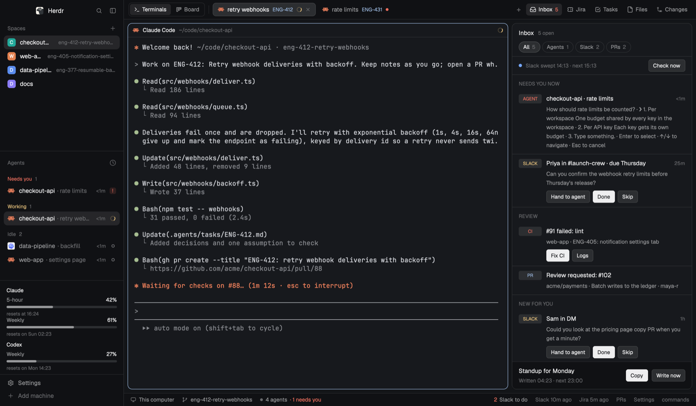
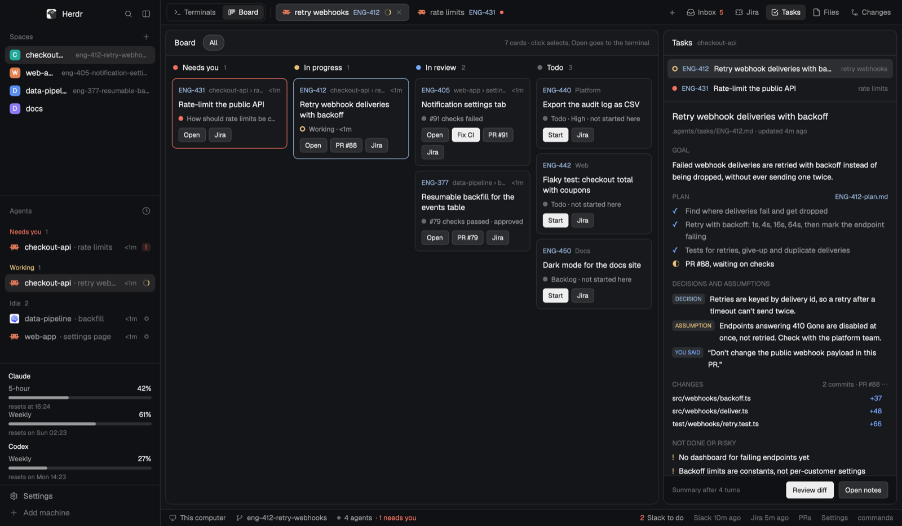

# Command Center for Herdr

A [Herdr](https://herdr.dev) app layout for running many coding agents at once, built on Herdr's own `main`: the same
spaces and agents sidebar, plus an **Inbox** of what needs you (blocked or finished agents, Slack asks, failed CI,
review requests), your **Jira** issues linked to the agents working on them, a **Tasks** summary per issue, a
**Board** of all work, a **standup** draft, and Claude Code and Codex **usage** bars. Pull requests and builds come
from **GitHub** or **Bitbucket Cloud**, whichever hosts the repo.

This is a fork of [digitaltracer/herdr-plugins](https://github.com/digitaltracer/herdr-plugins), which uses Linear and
GitHub only.





Needs macOS (the Keychain, `pbcopy`), the Herdr app, Node and Claude Code; `gh` signed in for GitHub repos and a
Bitbucket API token (below) for Bitbucket ones. Jira and Slack are read through the claude.ai connectors (Atlassian and
Slack), so connect those in claude.ai if you want them. Jira Cloud only: that's what the Atlassian connector reaches.

Both screenshots are made by `node scripts/preview.mjs` from made-up data (`scripts/preview/demo.json`) in a
separate Herdr window with its own home folder and herdr-core, so it never touches your spaces or logins.

## Install

```sh
node install.mjs            # copy layouts/ and mods/cc-* into ~/.config/herdr-app, then check each mod
node install.mjs --switch   # and switch the window to it (⌘⇧L cycles back)
node install.mjs --hooks    # also set up task notes (see below)
node install.mjs --uninstall
```

Edit here, then run `node install.mjs` again: Herdr reloads the mods in place. The installer only replaces folders
it installed itself (marked `.cc-managed`), and binds ⌘⌥1 and ⌘⌥2 (Terminals, Board) and ⌘⌥I, ⌘⌥J, ⌘⌥T (Inbox,
Jira, Tasks) in `keys.json`, leaving any key you already use. Over an install of the Linear version it removes
`cc-linear` and its ⌘⌥L binding.

### Bitbucket token

Repos whose `origin` is on bitbucket.org get their PRs through Bitbucket's REST API with an Atlassian API token:

1. At id.atlassian.com → Security → API tokens, **Create API token with scopes**, app **Bitbucket**, with
   `read:user:bitbucket`, `read:repository:bitbucket`, `read:pullrequest:bitbucket` and `read:pipeline:bitbucket`.
2. Copy it and store it in the Keychain, your Atlassian email as the account:

   ```sh
   printf 'add-generic-password -U -s herdr-bitbucket -a you@example.com -w %s\n' "$(pbpaste)" | security -i; pbcopy < /dev/null
   ```

   Not `security add-generic-password … -w` with a prompt: macOS cuts what you type there at 128 characters, and
   these tokens are longer. This way the token stays out of your shell history too.

The token is read from the Keychain for each check, sent only to `api.bitbucket.org`, and never written anywhere.
Settings → Bitbucket shows whether it's signed in.

## Settings

`~/.config/herdr-app/command-center.json`, edited from **Settings** in the status bar or by hand (read again each
minute). The installer writes it only when it's missing. New installs start with the paid Claude runs off:

| | Default | Cost |
|---|---|---|
| GitHub | on, every 3 min, review requests asked of you | free (`gh`) |
| Bitbucket | on (quiet until there's a token), with GitHub's interval | free (REST API) |
| Jira | on, every 15 min, 07–22, Haiku; your unresolved issues | under 1¢ a run |
| Slack sweep | **off**; when on, hourly, 09–19, Sonnet | 30–45¢ a run on Sonnet |
| Standup draft | **off**; when on, 23:00 on weekdays, Sonnet | about 25¢ a run |
| Repo folders | the folders of the repos open in Herdr | |
| Usage bars | Claude Code and Codex | free |

Jira also has **Site** (your `*.atlassian.net`; found and saved by the first check when empty), **JQL** (which issues
to list; empty is `assignee = currentUser() AND statusCategory != Done`) and **Branch name** for Start from issue:
`{key}` (`eng-412`), `{KEY}` (`ENG-412`) and `{slug}` (the title), `{key}-{slug}` by default, or a team convention
such as `feature/jd/{key}-{slug}`.

The dialog shows what a day costs at the settings you pick. When the Atlassian or Slack connector isn't signed in,
its panel says how to connect it (with **Check again** and **I don't use …**) and the scheduled runs wait instead of
paying to fail; a free check of Claude Code's own "needs sign-in" list catches most of these first.

## What's in it

| Mod | Where | What it does |
|---|---|---|
| `cc-tabs` | tab bar | Herdr's tab bar, with a Terminals | Board toggle (⌘⌥1, ⌘⌥2) and Inbox · Jira · Tasks · Files · Changes buttons (⌘⌥I, ⌘⌥J, ⌘⌥T), the Inbox count and each tab's Jira issue |
| `cc-board` | center (stack with the terminals) | One card per piece of work (agent, Jira issue and PR joined by branch) in Needs you, In progress, In review and Todo (backlog issues too); filters by the Start dialog's folders; click selects the tab and shows Tasks, Open goes to the terminal, plus Fix CI, PR, Start and Jira |
| `cc-inbox` | side panel | Blocked agents with their prompt, finished agents, Slack asks, failed CI on your branches' PRs (Fix CI starts Claude on it), PRs that request your review; the standup draft at its foot |
| `cc-jira` | side panel | Your open Jira issues by status, backlog included, each linked to the space and tab on its branch, with agent status and PR checks; Start on unlinked ones |
| `cc-start` | dialog | Start from issue: a new worktree on a branch named by your pattern, next to the repo as `<repo>-<issue key>` (or a tab), Claude in plan, auto or ask-first mode, the whole issue as its first message (description and comments, read from Jira as the dialog opens: a few seconds and under a cent), and optionally move the issue to In Progress |
| `cc-tasks` | side panel | For each tab of the shown space: goal, plan, decisions, assumptions, what's not done (from `.agents/tasks/`), plus changed files, commits and PR checks from git; a red box when the agent is waiting on you |
| `cc-handoff` | dialog | Hand a Slack ask to an agent: a new one (plan mode) or a free one in this space, optionally searching Slack first; the message is editable |
| `cc-standup` | pane | The standup draft as bullets: click to edit, × to drop, press-and-release on another bullet to move it there, ✦ or the box below to have Claude change one bullet or the whole draft; Undo (10 steps), Write now, Copy. Opened from the Inbox footer |
| `cc-usage` | sidebar foot | Claude Code and Codex plan usage: a bar per limit window with its reset time; amber from 70%, red from 90%; click to refresh |
| `cc-settings` | dialog | The settings above, with a daily cost estimate and the Bitbucket sign-in state |
| `cc-status` | status bar | Status bar, and the only fetcher: writes `cc.github` (PRs from both hosts), `cc.bitbucket`, `cc.snippets`, `cc.jira` and `cc.slack` to shared state |

What it runs: `git rev-parse` and `git remote get-url origin` once per folder; for each local space's feature branch
every 3 minutes, `gh pr view` on GitHub repos or two Bitbucket API calls (the branch's open PR, its commit's build
statuses) on Bitbucket ones; review requests every 5 minutes (`gh search prs user-review-requested:@me`, and on
Bitbucket the open PRs listing you as a reviewer in each Bitbucket repo open in Herdr or under the repo folders, since
Bitbucket has no workspace-wide search); and `hc read` once when an agent becomes blocked. Remote spaces and
`main`/`master` branches are skipped. Click the PRs time in the status bar to check now. A failed check keeps the
last results and shows its error there.

Jira is read through the claude.ai Atlassian connector: a headless `claude -p` (read-only tools, $0.50 cap) on the
schedule in settings, or when you click refresh. The model only calls Jira's search; the issues are read from that
tool's own answer in the run's output, not from what the model writes, so text inside an issue can't change the
list. Moving an issue to In Progress is a second run with Jira's transition tools, only when you tick it in Start
from issue; whether it moved is read from Jira's answer too. The runs work in `~/.config/herdr-app/data/cc-claude`
and keep no session. The connector's name is one constant, `JIRA_CONNECTOR` in `mods/cc-status/jira.js` (and the
tool name in `cc-start`), in case reconnecting it renames its tools.

Slack: a headless sweep of your DMs and @-mentions since the last sweep, on the schedule in settings, or Check now
in the Inbox. Read-only Slack tools only; it never posts. It also marks earlier
asks resolved once you've replied. Done means handled; Skip means set aside; FYIs get Seen. State is
`~/.config/herdr-app/data/cc-slack/state.json`; Done, Skip, Seen, Undo and Clear in
the Inbox go through cc-status, which owns that file. Urgent or dated new asks become toasts. Hand to agent opens
Claude in plan mode in the shown space to research the answer across Slack, Jira and the code, and draft a reply.

Fix CI opens Claude in the PR's repo with the failing checks and their links, asks it to find the cause, fix it on
the branch and run the tests, and not to push. Build logs behind a login (Bitbucket Pipelines) it asks you to paste.

Standup: the Inbox footer holds a draft answer to "What did you accomplish?" for the previous working day (Friday on
Monday), or for today from 18:00. Your commits in every repo under the Start dialog's folders, your PRs (`gh`, and
Bitbucket's API for Bitbucket repos), the day's task summaries and the Slack asks you closed (marked Done, or replied
to; never skipped ones, kept two weeks even after Clear) are gathered locally; one Sonnet run (about $0.25) adds Jira
(your issues updated that day and the ones whose status you changed, with their comments) and your own Slack
messages and writes it. It runs at the times in settings (before the "new day from" hour it writes the previous
working day, after it today), catches up a missed time within 12 hours if Herdr was closed or asleep, and runs on
demand from Write now in the Inbox footer or `herdr-app do cc-status.standup`. Once you edit a day's draft, the
schedule leaves it alone; Write now still replaces it (Undo brings yours back). Asking Claude to change it is one
Sonnet run with no tools, a few cents.

Usage: Claude Code's numbers come from the usage endpoint `/usage` uses, with Claude Code's login read from the macOS
Keychain (read only, never refreshed or stored), every 3 minutes, backing off to 15 after failures. Codex's come from
the newest session log under `~/.codex/sessions`, so they update when Codex runs.

Branches link to issues by key: a branch is an issue's when the key appears in it as a whole token
(`feature/jd/eng-412-…` and `ENG-412` are ENG-412's; `eng-4120` isn't), in any case.

## Task notes

`mods/cc-tasks/cc-task.mjs` decides where a task's notes live: `<repo>/.agents/tasks/<ISSUE>.md` when the branch belongs
to a Jira issue, else `<repo>/.agents/tasks/<space>.md` with a `## <tab>` section. It adds `.agents/tasks/` to the
repo's `.git/info/exclude`. `node install.mjs --hooks` sets up the two pieces that use it (backing up both files
first; adding twice changes nothing; `--uninstall` takes them out):

- `~/.claude/CLAUDE.md`: agents in Herdr terminals run `cc-task.mjs path` and keep that file current.
- `~/.claude/settings.json` Stop hook `cc-task.mjs hook`: after a turn that edited files, in a Herdr terminal only,
  starts a background Haiku run (about 1–2¢) that rewrites `.agents/tasks/.summary/<key>.json`. It returns at once.


## Credits

Forked from [digitaltracer/herdr-plugins](https://github.com/digitaltracer/herdr-plugins). Ideas and approaches from
[Bettr](https://github.com/dissimulate/bettr) (usage bars read from Claude Code's usage endpoint and Codex's session
logs, and the separate-window preview script) and from slack-panel in
[sachin-philip/wizardry](https://github.com/sachin-philip/wizardry) (a headless Claude sweep for Slack asks and a
standup draft).

## Licence

MIT, see [LICENSE](LICENSE).
