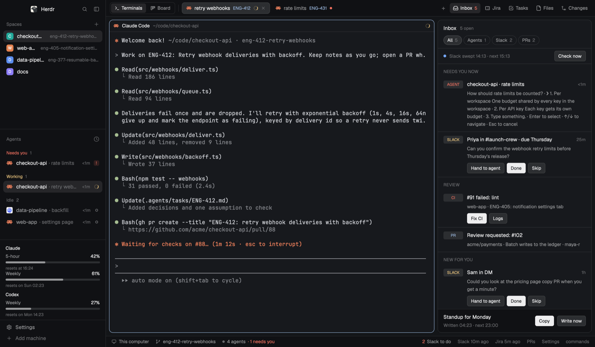

# Command Center

Herdr's own layout for people running many coding agents at once, with one place for what needs you: an Inbox of
blocked and finished agents, Slack asks, failed CI and review requests (GitHub or Bitbucket Cloud); your Jira issues
linked to the agents on them; a summary of each task; a Board of all work; a standup draft; and Claude Code and Codex
usage bars.

## What you see

- Herdr's `main` look and structure, unchanged except as below: a 268 px sidebar (`spaces`, `agents`), a 42 px tab
  bar, terminals as cards (8 px gap, 10 px corners, 30 px `pane` header, `accent` border on the focused one), a
  28 px status bar. All colours come from `theme()`, so every theme works, light and dark.
- **Tab bar**: at the left a two-way toggle, **Terminals | Board** (13 px icons, 24 px tall, `selected` when on),
  then the tabs (a Jira key such as `ENG-412` in `accent` after a tab's name when its branch belongs to an issue),
  then `+` and panel buttons **Inbox · Jira · Tasks · Files · Changes**. Inbox carries a count in `blocked`.
- **Side panel**, 392 px (280–900), one panel at a time:
  - **Inbox**: filter chips (All, Agents, Slack, PRs), a Slack sweep line (time swept, next, Check now), then
    sections NEEDS YOU NOW, REVIEW, NEW FOR YOU. Each row: a 50 px kind tag (AGENT `blocked`, DONE `done`, SLACK
    `working`, CI `blocked`, PR `accent`), title, age, body, and buttons. A blocked agent's body is its screen's
    question and options. At the foot, the standup: "Standup for Monday · Written 23:00 · next 11:00", Copy, Write now.
  - **Jira**: "My issues", groups by status (started first, Backlog last and shown until you fold it), rows with
    key, title, Highest/High, and either the linked space › tab with its agent status and PR checks, or **Start**.
  - **Tasks**: the shown space's tabs in git repos, then for the selected one: title, notes file and age, a red
    WAITING ON YOU box when its agent asks something, GOAL, PLAN (✓ ◐ ○), DECISIONS AND ASSUMPTIONS (tagged
    DECISION, ASSUMPTION, YOU SAID), CHANGES (files with +/−, commits, PR), NOT DONE OR RISKY; Review diff, Open notes.
- **Board** (in the centre, instead of the terminals): columns Needs you, In progress, In review, Todo, one card
  per piece of work: Jira key and space › tab, title, a status line with a dot, and buttons (Open, Fix CI, PR #,
  Start, Jira). Issues no tab works on, backlog ones too, sit in Todo. Filter chips by repo folder.
- **Sidebar foot** (above Settings): "Claude" and "Codex", each limit as three lines: name and percentage, a 5 px
  bar (`muted`, `working` from 70 %, `blocked` from 90 %), "resets on Mon 02:30" in `dim` 10.5 px.
- **Status bar**: machine, branch, agent count, then "2 Slack to do", "Slack 10m ago", "Jira 5m ago", "PRs just
  now" ("GitHub" when Bitbucket is off), **Settings**, the palette hint.
- **Dialogs**: Start from issue, Hand to agent (Slack), Settings (with a daily cost estimate); the standup opens as
  a pane beside the terminals.

## How it behaves

- Agent status: `blocked` → Inbox NEEDS YOU NOW and Board Needs you (red border); `done` → Inbox REVIEW and
  Board Needs you; `working` → Board In progress with time in state; `idle` → off the Board unless its branch
  has an issue or an open PR.
- Clicking an Inbox row opens the agent, thread or PR. Slack asks: **Hand to agent** (a dialog: a new Claude in
  plan mode or a free agent in this space, optionally search Slack first, editable message; it never posts),
  **Done** (counts toward the standup), **Skip** (doesn't); FYIs: **Seen**; closed ones: **Undo**.
- Board: clicking a card selects its tab and opens Tasks beside the Board; **Open** goes to the terminal; clicking
  any tab returns to Terminals. Cards for one issue or PR on several tabs merge (the agent's tab wins).
- Jira **Start**: worktree on a branch named by settings' `jira.branchPattern` (`{key}-{slug}` by default), next to
  the repo as `<repo>-<issue key>` (a new space), or a tab, Claude (plan, auto or ask-first) or Codex or a shell, the
  whole issue as the first message, repos listed from settings' folders with one suggested, and optionally Move to
  In Progress (a Jira transition to the status named In Progress, else the first in the In Progress category). The
  dialog reads the issue's full description and comments from Jira as it opens (one `getJiraIssue`; the list holds
  only the start of each description) and takes them from the tool's own answer, not from what the model writes
  back; Start waits for that, and a failed read offers Retry or a first message that says it is incomplete.
- Standup pane: click a bullet to edit, × drops it, press on one and release on another to move it, ✦ asks
  Claude to change one bullet, the box below changes the whole draft, Undo (10 steps).
- Keys: ⌘⌥1 Terminals, ⌘⌥2 Board, ⌘⌥I Inbox, ⌘⌥J Jira, ⌘⌥T Tasks. Clicking an open panel's button hides it;
  each space remembers its panel.
- When Jira (the Atlassian connector) or Slack isn't connected, its place says "Connect Jira to see your issues"
  (steps, **Check again**, **I don't use Jira**) and scheduled runs wait. With no Bitbucket token, Bitbucket stays
  quiet and Settings says how to add one.

## Built from

- `layouts/command-center.json`: Herdr's `main` tree with `tabs` → `cc-tabs`, `status` → `cc-status`, the `main`
  tab block wrapped in a `stack` `center` with a `board` block (`cc-board`), `panel-body` children `inbox`
  (`cc-inbox`), `jira` (`cc-jira`), `tasks` (`cc-tasks`), `files`, `changes`, and a `usage` block (`cc-usage`)
  before `sidebar-footer`. Shipped mods kept: `workspace-chrome`, `spaces`, `agents`, `pane`, `files`, `changes`,
  `worktree`, `menu`, `new-menu`.
- `cc-status` is the only fetcher, on a one-minute `cx.timer`: per local space's branch `gh pr view` (GitHub
  repos) or Bitbucket's REST API (`bitbucket.js`: the branch's open PR and its commit's build statuses, with a
  Keychain token), review requests from `gh search prs` and Bitbucket, `hc read` when an agent becomes blocked,
  headless `claude -p` runs for Jira (`jira.js`: stream-json, the issues parsed from the search tool's own result),
  the Slack sweep, the standup and standup edits (`--json-schema`, read-only tool lists), the Claude usage endpoint
  with Claude Code's Keychain login, and Codex's newest session log. It writes shared state (`cc.github` for PRs
  from both hosts, `cc.bitbucket`, `cc.snippets`, `cc.jira`, `cc.slack`, `cc.standup`, `cc.usage`, `cc.settings`);
  every other mod only reads, and sends changes back as `cc.*.request` / `cc.*.action` / `cc.settings.update`. It
  owns `command-center.json` and `data/cc-slack`, `data/cc-standup`.
- Dialogs and panes: `cc-start`, `cc-handoff`, `cc-settings` (overlays), `cc-standup` (`pane.split {mod}`).
- `mods/cc-tasks/cc-task.mjs` (Node): `path` for agents, `hook` (Claude Code Stop hook; starts a background Haiku
  summary into `<repo>/.agents/tasks/.summary/<key>.json`). `install.mjs --hooks` adds the CLAUDE.md rule and hook.
- Herdr commands used: `layout.select`, `layout.show/hide/resize`, `space.select`, `tab.select`, `tab.new`,
  `space.new`, `pane.split`, `pane.focus`, `agent.focus`.

## Watch out

- Herdr's `fs/promises` has no `rename`, and reads only inside HOME: write state files directly, keep them under
  the app home.
- `setShared` works only inside a `cx.spawn` task (or a handler), not in a bare promise callback: it fails silently.
- Publishing shared state: spread the previous value first and the fresh fields last, or stale values win.
- Gate paid schedules on an in-memory "started" time as well as saved state, or a failed save re-runs every minute.
- The first tick must wait for saved state to load, or a reload looks like "never ran".
- `claude -p` with `--json-schema` returns the answer in `structured_output`. Ask the model for `connected: false`
  rather than parsing its error text.
- `gh search prs --review-requested=@me` includes team requests (often dozens); `user-review-requested:@me` is direct.
- `git diff --numstat` skips untracked files; list them with `git ls-files --others --exclude-standard`.
- Claude Code's `~/.claude/mcp-needs-auth-cache.json` lists connectors needing sign-in; it's a hint, not an API.
  Match the connector's name at the end of a key: "Atlassian" must not match a separate "Atlassian MCP".
- The Atlassian connector answers `getJiraIssue` and `searchJiraIssuesUsingJql` as `{ issues: { nodes: [...] } }`,
  with markdown descriptions and comments in `fields.comment.comments`; links it shows as cards come wrapped in
  `<custom data-type="smartlink">url</custom>`. Status categories are `new`, `indeterminate`, `done`; priority
  names vary by site ("3. Medium"). Jira Cloud's JQL has no `updatedBy()`.
- `security add-generic-password … -w` prompts cut input at 128 characters; Atlassian API tokens are longer. Store
  them through `security -i` instead. Bitbucket API calls take Basic auth with the Atlassian email and the token.
- Bitbucket has no workspace-wide PR search for reviewers (`/workspaces/{ws}/pullrequests/{user}` is a 404): ask
  each repo with `q=reviewers.uuid="…" AND state="OPEN"`.
- Match issue keys in branch names as whole tokens: `includes("eng-41")` also matches `eng-412-…`.
- macOS only as built: Keychain (`security`), `pbcopy`, `open`.

## Done when

- `node install.mjs` prints `ok` for all eleven `cc-*` mods and `herdr-app status` shows no errors.
- `node scripts/preview.mjs` saves `preview.png` and `docs/board.png` showing the Inbox with five items and the
  Board with six cards, Tasks showing ENG-412's goal, plan, decisions, three changed files and two commits.
- ⌘⌥2 shows the Board and ⌘⌥1 the terminals; ⌘⌥I/J/T switch the panel.
- With the connectors signed in, the Jira panel lists your issues and a Check now in the Inbox fills the Slack
  section; with them signed out, both show their Connect message.
- With a Bitbucket token, Settings → Bitbucket says "Signed in as …", and a tab on a branch with an open Bitbucket
  PR gets its build state on the Board.
- Settings → Save changes `~/.config/herdr-app/command-center.json`, and the status bar follows within a minute.
